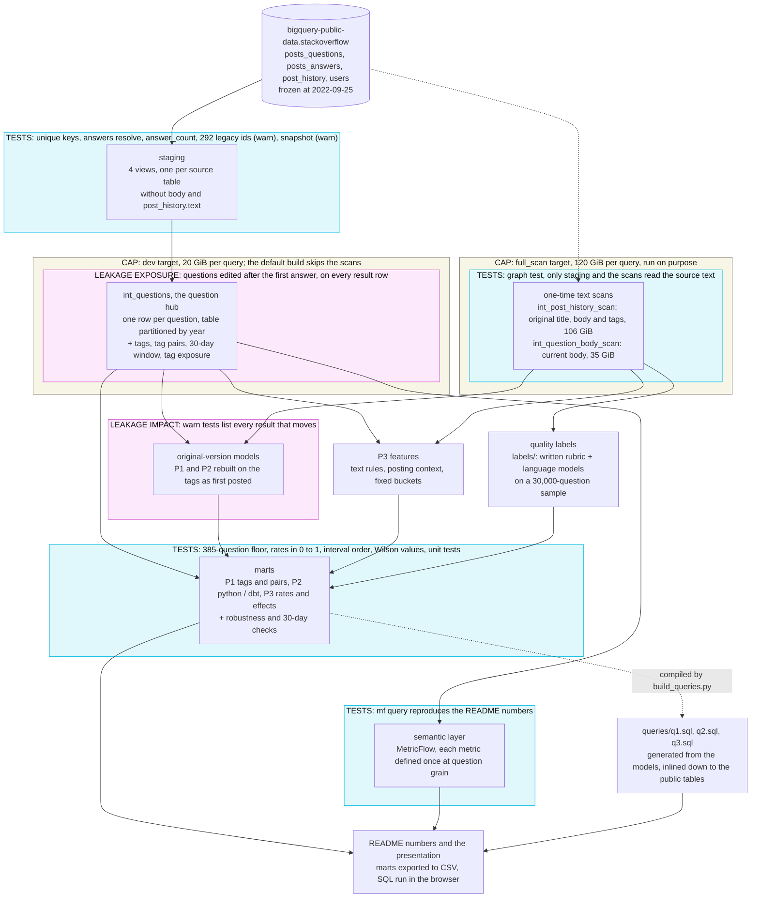

# Stack Overflow answerability

What makes a Stack Overflow question get answered, and get an accepted answer? Analysis of the
[`bigquery-public-data.stackoverflow`](https://console.cloud.google.com/marketplace/product/stack-exchange/stack-overflow)
dataset.

> Work in progress. Results land here first; method and limits follow each answer.

## Read this first

The public snapshot ends on **2022-09-25**. "Current year" in this analysis means **2022** (partial year). Details in
[`specs/000`](specs/000-shared-definitions.md).

## 1. Which tags get the most answers and accepted answers?

Sort every 2022 tag by accepted rate and the top 10 is ten tags with one or two questions each, all at 100%. The bottom
10 is the same story at 0%. So before any list, a rule for "enough questions to believe the rate"
([`eda/d1_sample_size`](eda/d1_sample_size/README.md)).

### The short answer

In 2022 the tags whose questions get answered and accepted are **text processing and data wrangling**: `jq`, `awk`,
`sed`, `regex`, R's `dplyr` / `tidyr` / `data.table`, `pandas-groupby`. Between 58% and 68% of their questions end with
an accepted answer, and `awk` and `sed` collect more than two answers per question. At the other end sit
**platforms and integrations**: `magento2`, `appium`, `facebook` and its Graph API, `ckeditor`, `elementor`, Chrome
extensions, `webview`, `cpanel`, `usb`. About one in ten of their questions gets an accepted answer, and most of them
never get any answer at all. For comparison, the whole of 2022 sits at **30.5%** (386,683 accepted out of 1,268,788
questions). Tag pairs tell the same story: R and pandas pairs, `jq + json` and `awk + bash` on top; Android, Chrome
extensions, WordPress plugins and websockets at the bottom.

My reading of the pattern (association, not cause): the tags on top are about small, self-contained problems where the
asker can paste an input and the expected output, someone can test an answer in a minute, and the asker can tell when it
worked. The tags at the bottom depend on an environment the person answering doesn't have (a store, an app review, a
browser build, a device on a USB port). P3 looks at this kind of question quality directly, without tags.

### How I measured it

- **Population**: questions created in 2022, the latest year in the snapshot (2022-01-01 to 2022-09-25, so a partial
  year). Tags are the tags each question has today.
- **Accepted rate** = questions with an accepted answer / **all** questions in the group. It is the ranking metric for
  "highest rate of approved answers". Two columns sit beside it so each row tells *why* it is high or low: **answer
  rate** (answered / all questions) and **accepted among answered** (accepted / answered). They multiply back:
  accepted rate = answer rate × accepted among answered.
- **Answers per question** = total answers / total questions in the group. It is my reading of "most answers"; the plain
  total of answers mostly measures how popular a tag is.
- **Floor: 385 questions** in the year. 385 is the smallest sample whose worst-case 95% margin of error is ±5 points.
  It leaves 1,162 tags and 1,026 tag pairs in 2022 (2.7% of the tags, but 76% of the question–tag links).
- **Ranking by the interval, not by the rate.** Each group gets a 95% interval (Wilson for the two rates, mean ±
  1.96 × standard error for answers per question). "Highest" lists sort by the **lower** bound, "lowest" lists by the
  **upper** bound, so a group only makes a list if it is high (or low) *and* well measured. That's why `jq` (67.6%,
  824 questions) ranks above `tidyr` (66.5%, 412 questions) even though their rates are close. Wilson rather than the
  plain rate ± 1.96 × standard error because the plain interval breaks near 0% and 100%: 1 accepted out of 10 gives
  −8.6% to 28.6%, and 1 out of 1 gives a zero-width 100% to 100%; Wilson gives 1.8% to 40.4% and 20.7% to 100%.
- **Combinations** are unordered tag pairs: a question tagged `r|dplyr|tidyverse` counts for `dplyr + r`,
  `dplyr + tidyverse` and `r + tidyverse`. Same floor, same rules.
- **Tag exposure** is the share of the group's questions whose tags were first edited *after* the first answer arrived
  (more on it below).

### Single tags, 2022

_Highest accepted rate_

| # | Tag | Questions | Accepted rate (95% interval) | Answer rate | Accepted among answered | Tag exposure |
|---:|---|---:|---:|---:|---:|---:|
| 1 | `jq` | 824 | 67.6% (64.3–70.7) | 97.3% | 69.5% | 19.2% |
| 2 | `awk` | 1,266 | 66.0% (63.4–68.6) | 95.3% | 69.3% | 14.5% |
| 3 | `data.table` | 696 | 66.5% (62.9–69.9) | 87.5% | 76.0% | 9.6% |
| 4 | `dplyr` | 4,093 | 64.2% (62.7–65.6) | 89.8% | 71.4% | 10.3% |
| 5 | `tidyr` | 412 | 66.5% (61.8–70.9) | 87.6% | 75.9% | 14.6% |
| 6 | `tidyverse` | 1,409 | 61.7% (59.1–64.2) | 85.1% | 72.5% | 6.9% |
| 7 | `pandas-groupby` | 997 | 62.1% (59.0–65.0) | 85.0% | 73.1% | 16.8% |
| 8 | `data-manipulation` | 476 | 63.4% (59.0–67.6) | 85.5% | 74.2% | 13.0% |
| 9 | `sed` | 1,085 | 61.8% (58.9–64.7) | 93.6% | 66.0% | 16.4% |
| 10 | `regex` | 7,394 | 58.5% (57.4–59.6) | 87.4% | 66.9% | 11.2% |

_Lowest accepted rate_

| # | Tag | Questions | Accepted rate (95% interval) | Answer rate | Accepted among answered | Tag exposure |
|---:|---|---:|---:|---:|---:|---:|
| 1 | `magento2` | 488 | 8.6% (6.4–11.4) | 41.2% | 20.9% | 0.6% |
| 2 | `appium` | 588 | 9.5% (7.4–12.2) | 40.5% | 23.5% | 0.3% |
| 3 | `facebook` | 962 | 10.2% (8.4–12.3) | 27.2% | 37.4% | 0.7% |
| 4 | `ckeditor` | 414 | 9.4% (7.0–12.6) | 27.8% | 33.9% | 0.5% |
| 5 | `elementor` | 557 | 10.1% (7.8–12.8) | 47.2% | 21.3% | 1.6% |
| 6 | `facebook-graph-api` | 548 | 10.4% (8.1–13.2) | 26.8% | 38.8% | 1.3% |
| 7 | `cpanel` | 422 | 10.2% (7.7–13.4) | 37.2% | 27.4% | 2.6% |
| 8 | `usb` | 387 | 10.3% (7.7–13.8) | 35.7% | 29.0% | 1.8% |
| 9 | `object-detection` | 618 | 11.2% (8.9–13.9) | 36.6% | 30.5% | 3.1% |
| 10 | `tableau-desktop` | 404 | 10.9% (8.2–14.3) | 42.8% | 25.4% | 0.2% |

The two side columns split the bottom in two kinds of trouble. `facebook`, `ckeditor` and the Graph API are mostly
**not answered** (about 27% answer rate; when they are, more than a third get accepted). `magento2`, `appium` and
`elementor` get answered more often (40–47%) but **rarely accepted** (21–24% of the answered ones). Different
problems, same rank (sorry, `magento2`).

_Most answers per question_

| # | Tag | Questions | Answers per question (95% interval) | Answer rate | Tag exposure |
|---:|---|---:|---:|---:|---:|
| 1 | `awk` | 1,266 | 2.45 (2.37–2.54) | 95.3% | 14.5% |
| 2 | `sed` | 1,085 | 2.19 (2.10–2.28) | 93.6% | 16.4% |
| 3 | `grep` | 643 | 1.79 (1.68–1.90) | 85.8% | 15.6% |
| 4 | `java-stream` | 820 | 1.70 (1.62–1.78) | 91.3% | 37.1% |
| 5 | `list-comprehension` | 491 | 1.69 (1.59–1.79) | 91.0% | 10.8% |
| 6 | `list` | 10,067 | 1.52 (1.50–1.54) | 84.2% | 8.7% |
| 7 | `dplyr` | 4,093 | 1.49 (1.46–1.52) | 89.8% | 10.3% |
| 8 | `data.table` | 696 | 1.53 (1.45–1.61) | 87.5% | 9.6% |
| 9 | `jq` | 824 | 1.49 (1.43–1.54) | 97.3% | 19.2% |
| 10 | `split` | 1,304 | 1.50 (1.43–1.56) | 84.7% | 12.8% |

_Fewest answers per question_

| # | Tag | Questions | Answers per question (95% interval) | Answer rate | Tag exposure |
|---:|---|---:|---:|---:|---:|
| 1 | `facebook-graph-api` | 548 | 0.31 (0.26–0.35) | 26.8% | 1.3% |
| 2 | `facebook` | 962 | 0.32 (0.29–0.36) | 27.2% | 0.7% |
| 3 | `ckeditor` | 414 | 0.31 (0.26–0.36) | 27.8% | 0.5% |
| 4 | `chrome-extension-manifest-v3` | 423 | 0.33 (0.28–0.38) | 30.0% | 1.9% |
| 5 | `google-chrome-extension` | 2,032 | 0.37 (0.34–0.39) | 32.1% | 1.3% |
| 6 | `soap` | 832 | 0.37 (0.33–0.41) | 33.7% | 1.2% |
| 7 | `proxy` | 1,206 | 0.39 (0.36–0.42) | 34.8% | 1.2% |
| 8 | `webview` | 993 | 0.41 (0.37–0.45) | 34.1% | 0.9% |
| 9 | `usb` | 387 | 0.39 (0.34–0.45) | 35.7% | 1.8% |
| 10 | `reverse-proxy` | 484 | 0.40 (0.35–0.45) | 35.7% | 1.0% |

The answer-rate lists (in [`queries/q1.sql`](queries/q1.sql)) add one useful case: `jmeter` has the second-highest
answer rate (96.0%) but only 31.6% accepted, a tag where almost everything gets a reply and few replies get the tick.

### Tag pairs, 2022

The same rules on pairs. Short version: R and pandas pairs plus `jq + json` and `awk + bash` on top; Android, Chrome
extensions, WordPress and websockets at the bottom. `arrays + google-sheets` leads with 85.8%, but read the edits
section before quoting it.

The four pair tables

_Highest accepted rate_

| # | Pair | Questions | Accepted rate (95% interval) | Answer rate | Accepted among answered | Tag exposure |
|---:|---|---:|---:|---:|---:|---:|
| 1 | `arrays + google-sheets` | 400 | 85.8% (82.0–88.8) | 96.8% | 88.6% | 64.0% |
| 2 | `dataframe + dplyr` | 645 | 72.7% (69.1–76.0) | 94.6% | 76.9% | 21.2% |
| 3 | `jq + json` | 518 | 68.7% (64.6–72.6) | 96.9% | 70.9% | 25.3% |
| 4 | `dplyr + tidyverse` | 515 | 68.0% (63.8–71.8) | 91.8% | 74.0% | 9.1% |
| 5 | `data.table + r` | 680 | 67.2% (63.6–70.6) | 87.9% | 76.4% | 9.9% |
| 6 | `dplyr + r` | 3,963 | 64.7% (63.2–66.2) | 90.1% | 71.9% | 10.5% |
| 7 | `r + tidyr` | 398 | 67.8% (63.1–72.2) | 88.4% | 76.7% | 15.1% |
| 8 | `regex + string` | 461 | 67.5% (63.1–71.6) | 93.1% | 72.5% | 17.4% |
| 9 | `dataframe + pandas-groupby` | 576 | 66.5% (62.5–70.2) | 88.9% | 74.8% | 24.0% |
| 10 | `awk + bash` | 514 | 66.0% (61.8–69.9) | 95.5% | 69.0% | 15.0% |

_Lowest accepted rate_

| # | Pair | Questions | Accepted rate (95% interval) | Answer rate | Accepted among answered | Tag exposure |
|---:|---|---:|---:|---:|---:|---:|
| 1 | `android + webview` | 485 | 9.9% (7.5–12.9) | 30.9% | 32.0% | 1.2% |
| 2 | `google-chrome + google-chrome-extension` | 477 | 10.3% (7.9–13.3) | 27.0% | 38.0% | 0.8% |
| 3 | `elementor + wordpress` | 442 | 11.5% (8.9–14.9) | 48.9% | 23.6% | 1.4% |
| 4 | `android + python` | 387 | 11.6% (8.8–15.2) | 35.4% | 32.8% | 1.6% |
| 5 | `plugins + wordpress` | 399 | 11.8% (9.0–15.3) | 33.6% | 35.1% | 0.5% |
| 6 | `amazon-web-services + aws-amplify` | 406 | 12.6% (9.7–16.1) | 43.1% | 29.1% | 1.2% |
| 7 | `android + unity3d` | 445 | 12.8% (10.0–16.2) | 44.7% | 28.6% | 1.1% |
| 8 | `google-chrome-extension + javascript` | 1,151 | 14.2% (12.3–16.4) | 34.6% | 41.2% | 1.3% |
| 9 | `ios + javascript` | 484 | 13.2% (10.5–16.5) | 38.0% | 34.8% | 0.4% |
| 10 | `android + react-native` | 2,274 | 15.1% (13.7–16.7) | 44.1% | 34.3% | 1.3% |

_Most answers per question_

| # | Pair | Questions | Answers per question (95% interval) | Answer rate | Tag exposure |
|---:|---|---:|---:|---:|---:|
| 1 | `awk + bash` | 514 | 2.59 (2.44–2.73) | 95.5% | 15.0% |
| 2 | `bash + sed` | 503 | 2.32 (2.18–2.46) | 94.4% | 13.5% |
| 3 | `list + string` | 557 | 1.88 (1.77–1.99) | 91.2% | 11.1% |
| 4 | `java + java-stream` | 754 | 1.77 (1.69–1.85) | 93.2% | 39.9% |
| 5 | `r + string` | 532 | 1.79 (1.68–1.90) | 89.3% | 18.0% |
| 6 | `list + python` | 6,336 | 1.69 (1.66–1.72) | 87.9% | 8.6% |
| 7 | `list-comprehension + python` | 413 | 1.77 (1.66–1.88) | 91.5% | 11.4% |
| 8 | `dictionary + list` | 1,187 | 1.72 (1.66–1.79) | 90.6% | 9.3% |
| 9 | `regex + string` | 461 | 1.75 (1.65–1.86) | 93.1% | 17.4% |
| 10 | `dataframe + dplyr` | 645 | 1.71 (1.63–1.79) | 94.6% | 21.2% |

_Fewest answers per question_

| # | Pair | Questions | Answers per question (95% interval) | Answer rate | Tag exposure |
|---:|---|---:|---:|---:|---:|
| 1 | `google-chrome + google-chrome-extension` | 477 | 0.30 (0.25–0.34) | 27.0% | 0.8% |
| 2 | `android + webview` | 485 | 0.36 (0.31–0.42) | 30.9% | 1.2% |
| 3 | `google-chrome-extension + javascript` | 1,151 | 0.40 (0.36–0.43) | 34.6% | 1.3% |
| 4 | `plugins + wordpress` | 399 | 0.38 (0.33–0.44) | 33.6% | 0.5% |
| 5 | `python + websocket` | 463 | 0.39 (0.34–0.45) | 35.2% | 1.1% |
| 6 | `android + python` | 387 | 0.39 (0.34–0.45) | 35.4% | 1.6% |
| 7 | `amazon-cognito + amazon-web-services` | 455 | 0.42 (0.37–0.48) | 37.6% | 1.1% |
| 8 | `node.js + websocket` | 397 | 0.43 (0.37–0.48) | 37.8% | 0.3% |
| 9 | `google-chrome + javascript` | 955 | 0.46 (0.41–0.50) | 36.8% | 1.5% |
| 10 | `nginx + nginx-reverse-proxy` | 440 | 0.45 (0.40–0.50) | 40.7% | 1.4% |

### How sure can we be about these lists?

- **Every list is sorted by a 95% interval**, shown on every row. For answers per question the interval assumes the
  mean is close to normal, which a skewed count like answers can break. Each row carries a flag for that (Cochran's
  rule, n > 25 × skewness²): it fails for 6 tags and 8 pairs in 2022, all in the middle of the table. **No flagged row
  lands in any top or bottom 10**, so none of the rows above needs the "interval approximate" label.
- **Two other ranking methods agree.** Ranking by the raw rate (same floor) and by an empirical-Bayes rate, which pulls
  small groups toward the average, give almost the same accepted-rate lists: 9 of 10 at the top and 10 of 10 at the
  bottom for tags; 9–10 of 10 at the top and 8 of 10 at the bottom for pairs. For answers per question a bootstrap
  interval changed nothing either ([`eda/d1_answers_ranking`](eda/d1_answers_ranking/README.md)).
- **2021 as a check year.** Of the 2022 top 10 tags by accepted rate, 8 were also in the 2021 top 10; at the bottom, 4.
  Pairs move more (3 of 10 at the top, 6 at the bottom), which is expected: a pair near the 385 floor drifts in and out
  of the ranked set. No tag or pair jumps from a top 10 to a bottom 10 between the years. Two 2021 leaders, `purrr` and
  `stringr`, vanish from 2022 because they fell under the floor, not because their rate dropped.
- **Time to collect answers (censoring).** A question from late September 2022 had days, not months, to get answered.
  Counting only answers that arrived within 30 days, on questions old enough to have had those 30 days, keeps 1,020 of
  the 1,162 tags; 9 of the top 10 and 6 of the bottom 10 by accepted rate stay the same (answers per question: 9 and 7).

### Do tag edits change the lists?

Tags get edited, and sometimes the edit comes after the answer: someone answers a question about filtering rows, then
adds `dplyr` because that's what the answer used. Read naively, the tag "led to" the answer, when the answer led to the
tag. That is what **tag exposure** measures, and it sits right where the headline is: the median ranked tag has 3.7%,
but the top 10 by accepted rate has 7–19% (`jq`: 19.2%), while the bottom 10 stays at or under 3.1%. `webdriverwait` is the
extreme case at 62%, a tag mostly added by the people answering.

To size the effect, the dbt project rebuilds every 2022 ranking on the **original** tags (the version the asker posted,
from `post_history`) and a `warn` test lists every tag or pair that enters or leaves a top / bottom 10, or whose accepted
rate moves by more than 2.5 points (half of the ±5-point precision target). Result: **46 tags and 65 pairs**.

- **Tags: 9 of 10 stay in both accepted-rate lists.** `tidyr` (#5) has fewer than 385 questions on the original tags:
  a good part of its questions got the tag later. `java-stream` takes its place. At the bottom, `usb` (#8) drops under
  the floor and `video-streaming` comes in. The largest moves are mid-table: `macros` 46.4% → 32.2%, `cuda` 45.5% →
  32.1%.
- **Pairs: 7 of 10 stay at the top, 8 of 10 at the bottom.** The #1 pair, `arrays + google-sheets` (85.8%, exposure
  64%), has fewer than 385 questions on the original tags, so **I wouldn't quote it as a finding**: most of that pair is
  made by retagging after an answer. `r + tidyr` goes the same way.

The single-tag answer above holds on the original tags; the pair list is softer at the top.

Every warning of the original-tags check (46 tags, 65 pairs)

**Single tags: 46 warnings**

| Tag | Why | Accepted rate, current tags | Accepted rate, original tags | Tag exposure |
|---|---|---:|---:|---:|
| `video-streaming` | bottom 10 changes (rank 13 → 8) | 11.5% | 11.0% | 0.8% |
| `java-stream` | top 10 changes (rank 11 → 10) | 59.8% | 59.3% | 37.1% |
| `tidyr` | top 10 changes (below the floor on original tags) | 66.5% | n/a | 14.6% |
| `usb` | bottom 10 changes (below the floor on original tags) | 10.3% | n/a | 1.8% |
| `macros` | moves > 2.5 pt | 46.4% | 32.2% | 4.7% |
| `cuda` | moves > 2.5 pt | 45.5% | 32.1% | 5.4% |
| `rstudio` | moves > 2.5 pt | 19.4% | 25.8% | 2.1% |
| `lambda` | moves > 2.5 pt | 46.4% | 40.4% | 7.3% |
| `vim` | moves > 2.5 pt | 39.2% | 33.3% | 5.9% |
| `match` | moves > 2.5 pt | 51.3% | 45.5% | 15.8% |
| `sum` | moves > 2.5 pt | 50.7% | 44.9% | 16.4% |
| `url-rewriting` | moves > 2.5 pt | 30.0% | 24.4% | 14.1% |
| `google-sheets-api` | moves > 2.5 pt | 39.8% | 34.3% | 20.7% |
| `gatsby` | moves > 2.5 pt | 39.7% | 34.4% | 7.1% |
| `sql-update` | moves > 2.5 pt | 43.9% | 38.8% | 20.0% |
| `ssms` | moves > 2.5 pt | 23.5% | 28.5% | 7.1% |
| `tradingview-api` | moves > 2.5 pt | 12.6% | 17.2% | 0.9% |
| `count` | moves > 2.5 pt | 51.3% | 46.8% | 15.1% |
| `django-queryset` | moves > 2.5 pt | 41.4% | 36.9% | 14.3% |
| `apache-spark-sql` | moves > 2.5 pt | 37.7% | 33.3% | 19.5% |
| `css-selectors` | moves > 2.5 pt | 46.1% | 41.8% | 31.6% |
| `aggregation-framework` | moves > 2.5 pt | 52.3% | 48.2% | 16.3% |
| `stream` | moves > 2.5 pt | 28.2% | 32.2% | 3.6% |
| `oracle-sqldeveloper` | moves > 2.5 pt | 30.1% | 34.0% | 8.0% |
| `flutter-layout` | moves > 2.5 pt | 39.1% | 35.5% | 13.1% |
| `max` | moves > 2.5 pt | 52.4% | 48.8% | 15.3% |
| `opengl` | moves > 2.5 pt | 38.6% | 35.0% | 9.4% |
| `angularjs` | moves > 2.5 pt | 16.1% | 19.6% | 2.0% |
| `asp.net-core-mvc` | moves > 2.5 pt | 37.2% | 33.8% | 12.2% |
| `extract` | moves > 2.5 pt | 39.1% | 35.7% | 9.7% |
| `apache` | moves > 2.5 pt | 20.7% | 17.3% | 8.1% |
| `google-oauth` | moves > 2.5 pt | 24.8% | 21.6% | 15.8% |
| `group-by` | moves > 2.5 pt | 55.5% | 52.3% | 14.0% |
| `slice` | moves > 2.5 pt | 49.7% | 46.6% | 12.8% |
| `case` | moves > 2.5 pt | 46.1% | 43.2% | 13.3% |
| `apache-spark` | moves > 2.5 pt | 28.1% | 25.2% | 11.5% |
| `kql` | moves > 2.5 pt | 60.3% | 57.4% | 6.8% |
| `web-applications` | moves > 2.5 pt | 20.5% | 17.7% | 7.1% |
| `react-router-dom` | moves > 2.5 pt | 46.1% | 43.3% | 19.5% |
| `tensor` | moves > 2.5 pt | 40.2% | 37.5% | 10.9% |
| `filter` | moves > 2.5 pt | 42.3% | 39.6% | 9.1% |
| `etl` | moves > 2.5 pt | 22.0% | 19.3% | 9.7% |
| `cors` | moves > 2.5 pt | 30.0% | 27.4% | 5.9% |
| `query-optimization` | moves > 2.5 pt | 33.8% | 31.2% | 11.2% |
| `json.net` | moves > 2.5 pt | 47.3% | 44.8% | 14.0% |
| `xpath` | moves > 2.5 pt | 49.6% | 47.1% | 26.0% |

**Tag pairs: 65 warnings**

| Pair | Why | Accepted rate, current tags | Accepted rate, original tags | Tag exposure |
|---|---|---:|---:|---:|
| `dataframe + pandas-groupby` | top 10 changes (rank 9 → 12) | 66.5% | 63.4% | 24.0% |
| `ios + javascript` | bottom 10 changes (rank 9 → 11) | 13.2% | 13.8% | 0.4% |
| `python + regex` | top 10 changes (rank 13 → 8) | 62.9% | 63.4% | 10.4% |
| `list + r` | top 10 changes (rank 16 → 10) | 62.5% | 62.9% | 9.0% |
| `r + tidyverse` | top 10 changes (rank 15 → 9) | 62.3% | 62.1% | 7.1% |
| `heroku + reactjs` | bottom 10 changes (rank 12 → 9) | 13.4% | 13.5% | 2.2% |
| `reactjs + webpack` | bottom 10 changes (rank 13 → 10) | 14.9% | 15.0% | 1.8% |
| `android + python` | bottom 10 changes (below the floor on original tags) | 11.6% | n/a | 1.6% |
| `arrays + google-sheets` | top 10 changes (below the floor on original tags) | 85.8% | n/a | 64.0% |
| `r + tidyr` | top 10 changes (below the floor on original tags) | 67.8% | n/a | 15.1% |
| `apache-spark + apache-spark-sql` | moves > 2.5 pt | 39.2% | 29.6% | 26.3% |
| `.htaccess + apache` | moves > 2.5 pt | 45.5% | 37.0% | 29.6% |
| `django-templates + python` | moves > 2.5 pt | 46.7% | 39.1% | 23.6% |
| `dataframe + pyspark` | moves > 2.5 pt | 47.5% | 41.4% | 27.2% |
| `apache-spark-sql + pyspark` | moves > 2.5 pt | 43.2% | 37.2% | 24.5% |
| `apache-spark + pyspark` | moves > 2.5 pt | 34.5% | 28.8% | 18.0% |
| `django-views + python` | moves > 2.5 pt | 45.2% | 39.6% | 19.2% |
| `dart + flutter-layout` | moves > 2.5 pt | 43.5% | 38.2% | 21.0% |
| `arrays + filter` | moves > 2.5 pt | 54.8% | 49.6% | 13.9% |
| `javascript + vuejs2` | moves > 2.5 pt | 42.3% | 37.2% | 15.3% |
| `apache-spark + python` | moves > 2.5 pt | 35.7% | 30.8% | 16.3% |
| `amazon-web-services + terraform` | moves > 2.5 pt | 41.8% | 36.9% | 19.6% |
| `google-cloud-firestore + javascript` | moves > 2.5 pt | 42.7% | 38.0% | 16.8% |
| `javascript + react-router-dom` | moves > 2.5 pt | 45.8% | 41.2% | 25.4% |
| `django-templates + django-views` | moves > 2.5 pt | 42.9% | 38.3% | 14.2% |
| `django-models + django-templates` | moves > 2.5 pt | 43.4% | 39.0% | 12.8% |
| `react-router + react-router-dom` | moves > 2.5 pt | 50.6% | 46.3% | 26.1% |
| `django + django-queryset` | moves > 2.5 pt | 42.7% | 38.3% | 15.1% |
| `firebase + java` | moves > 2.5 pt | 31.0% | 26.9% | 20.0% |
| `json + sql` | moves > 2.5 pt | 46.2% | 42.1% | 11.4% |
| `aggregation-framework + mongodb` | moves > 2.5 pt | 52.4% | 48.3% | 16.5% |
| `amazon-cloudformation + amazon-web-services` | moves > 2.5 pt | 38.8% | 34.7% | 12.8% |
| `django-models + python` | moves > 2.5 pt | 40.7% | 36.7% | 14.9% |
| `javascript + vuejs3` | moves > 2.5 pt | 41.7% | 37.9% | 13.9% |
| `flutter + flutter-layout` | moves > 2.5 pt | 39.6% | 35.9% | 13.3% |
| `lambda + python` | moves > 2.5 pt | 48.6% | 44.9% | 5.5% |
| `azure + terraform` | moves > 2.5 pt | 41.0% | 37.3% | 12.3% |
| `keras + machine-learning` | moves > 2.5 pt | 26.3% | 22.7% | 8.1% |
| `vue.js + vuejs3` | moves > 2.5 pt | 40.8% | 37.3% | 13.3% |
| `selenium + xpath` | moves > 2.5 pt | 53.2% | 49.8% | 42.6% |
| `vue.js + vuejs2` | moves > 2.5 pt | 39.0% | 35.7% | 11.8% |
| `tensorflow + tensorflow2.0` | moves > 2.5 pt | 32.2% | 29.0% | 13.7% |
| `keras + python` | moves > 2.5 pt | 29.2% | 25.9% | 7.9% |
| `firebase + kotlin` | moves > 2.5 pt | 33.1% | 29.9% | 18.2% |
| `firebase + javascript` | moves > 2.5 pt | 35.5% | 32.3% | 12.6% |
| `algorithm + arrays` | moves > 2.5 pt | 50.9% | 47.8% | 14.5% |
| `django-forms + django-views` | moves > 2.5 pt | 38.4% | 35.3% | 7.3% |
| `wpf + xaml` | moves > 2.5 pt | 44.4% | 41.3% | 14.1% |
| `javascript + string` | moves > 2.5 pt | 47.3% | 44.3% | 10.3% |
| `dataframe + dplyr` | moves > 2.5 pt | 72.7% | 69.7% | 21.2% |
| `sql + stored-procedures` | moves > 2.5 pt | 33.5% | 30.5% | 7.7% |
| `java + list` | moves > 2.5 pt | 46.9% | 44.0% | 26.3% |
| `react-router-dom + reactjs` | moves > 2.5 pt | 47.0% | 44.1% | 20.0% |
| `date + r` | moves > 2.5 pt | 56.1% | 59.0% | 8.6% |
| `asp.net-core-webapi + c#` | moves > 2.5 pt | 36.8% | 34.0% | 9.1% |
| `django-models + django-views` | moves > 2.5 pt | 41.8% | 39.0% | 11.1% |
| `pandas-groupby + python` | moves > 2.5 pt | 64.0% | 61.2% | 20.4% |
| `amazon-ecs + amazon-web-services` | moves > 2.5 pt | 32.4% | 29.7% | 5.6% |
| `discord + node.js` | moves > 2.5 pt | 40.1% | 37.5% | 9.7% |
| `html + web` | moves > 2.5 pt | 24.7% | 27.3% | 1.4% |
| `java + javascript` | moves > 2.5 pt | 20.1% | 22.7% | 4.3% |
| `join + sql` | moves > 2.5 pt | 53.4% | 50.9% | 16.3% |
| `jupyter-notebook + pandas` | moves > 2.5 pt | 33.3% | 35.9% | 3.1% |
| `android-studio + java` | moves > 2.5 pt | 18.2% | 20.7% | 1.6% |
| `android + firebase` | moves > 2.5 pt | 25.7% | 23.2% | 13.3% |

### Assumptions and limitations

- **"Lead to" is read as association.** A tag is a label for a kind of problem; this does not show that adding `jq` to
  a question would get it answered.
- **A question counts once for each of its tags**, so lists overlap: most `dplyr` questions are also `r` questions, and
  `dplyr + r` is close to `dplyr`.
- **2022 is partial** (to 09-25) and its newest questions are censored; the 30-day check above covers it.
- **Survivorship.** Deleted questions are not in the data, and Stack Overflow deletes mostly unanswered, low-score ones.
  So every rate here is biased upward, probably more for the tags at the bottom, which means the real gap between top
  and bottom is likely a bit wider than shown.
- **Current tags**, with the exposure column and the original-tags check above as the measure of the edit problem.
- **Pairs only.** Triples and exact tag sets were left out: at a 385-question floor very few of them qualify.

Spec, acceptance criteria and their tests: [`specs/001`](specs/001-q1-tag-answerability.md),
[`TESTING.md`](TESTING.md). Run it yourself: [`queries/q1.sql`](queries/q1.sql) (BigQuery console, about 9 GB, no dbt
needed).

## 2. python-only vs dbt-only, year over year

Two populations with very different sizes: python-only has 7,800 to 16,300 questions per year; dbt-only exists only
from 2020, with **31, 58 and 79 questions**. So the python half of this answer is a trend and the dbt half is mostly
an interval.

### The short answer

- **python-only answers per question fell from 2.31 in 2013 to 1.52 in 2021** (and 1.26 in 2022, a partial year). The
  accepted rate fell from 65.2% to 43.0% (35.4% in 2022). The decline happens almost every year; the biggest single
  drop is 2021 → 2022, and most of that one is not a quality signal (see censoring below).
- **dbt-only: 1.39, 1.14 and 1.06 answers per question** (2020 to 2022), with an accepted rate of 41.9%, 25.9% and
  27.8%. The intervals overlap year to year, so **I can't claim a dbt trend** in either metric.
- **Compared, dbt-only questions got fewer answers per question than python-only in 2021 and 2022** (the intervals don't
  touch) and a lower accepted rate in 2021 (25.9% vs 43.0%). In 2020, and for the 2022 accepted rate, the dbt intervals
  are too wide to separate them.

### How I read the prompt

- **"Only python" / "only dbt"** means the question's tags are *exactly* `python` or *exactly* `dbt`: one tag, nothing
  else (`python|pandas` and `python-3.x` are out). Literal, and it makes the python group small and peculiar: most
  Python questions carry more than one tag.
- **Last 10 years** = 2013 to 2022, by the question's creation year; answers count in their question's year. 2022 ends
  on 09-25.
- **Question-to-answer ratio.** I report it as **answers per question** (total answers / total questions), the same
  metric as "most answers" in P1, because "higher = more answers" reads naturally. For the literal ratio,
  **Q÷A = 1 / this**: python-only had 0.43 questions per answer in 2013 and 0.79 in 2022.
- **Year over year** for answers per question is the **absolute** difference, with the relative one in parentheses.
  Relative changes don't survive the inversion: python 2021 → 2022 is −17% in answers per question and +21% in questions
  per answer. Accepted-rate changes are in percentage points.
- **Accepted rate** is over all questions, with answer rate and accepted among answered beside it (same as P1).

### python-only

| Year | Questions | Answers per question (95% interval) | YoY, absolute (relative) | Accepted rate (95% interval) | YoY, points | Answer rate | Accepted among answered | Tag exposure |
|---|---:|---:|---:|---:|---:|---:|---:|---:|
| 2013 | 7,819 | 2.31 (2.27–2.35) |  | 65.2% (64.1–66.2) |  | 97.2% | 67.0% | 4.5% |
| 2014 | 8,537 | 1.97 (1.94–2.00) | -0.34 (-15%) | 61.5% (60.4–62.5) | -3.7 | 95.6% | 64.3% | 3.9% |
| 2015 | 9,781 | 1.90 (1.87–1.93) | -0.07 (-3%) | 56.9% (55.9–57.9) | -4.6 | 93.7% | 60.7% | 3.7% |
| 2016 | 10,344 | 1.83 (1.81–1.86) | -0.07 (-3%) | 52.5% (51.6–53.5) | -4.4 | 91.8% | 57.2% | 3.6% |
| 2017 | 11,683 | 1.70 (1.68–1.72) | -0.13 (-7%) | 49.1% (48.2–50.0) | -3.4 | 88.9% | 55.2% | 3.6% |
| 2018 | 11,614 | 1.69 (1.67–1.72) | -0.01 (-0.4%) | 49.2% (48.3–50.1) | +0.1 | 89.2% | 55.2% | 4.0% |
| 2019 | 14,503 | 1.70 (1.68–1.72) | +0.01 (+1%) | 48.8% (48.0–49.6) | -0.4 | 89.5% | 54.5% | 3.7% |
| 2020 | 16,256 | 1.65 (1.63–1.67) | -0.05 (-3%) | 45.5% (44.7–46.3) | -3.3 | 88.0% | 51.7% | 5.1% |
| 2021 | 15,811 | 1.52 (1.50–1.54) | -0.13 (-8%) | 43.0% (42.2–43.8) | -2.5 | 84.8% | 50.7% | 4.3% |
| 2022 (to 09-25) | 12,809 | 1.26 (1.24–1.28) | -0.26 (-17%) | 35.4% (34.6–36.2) | -7.6 | 73.5% | 48.1% | 3.8% |

### dbt-only

| Year | Questions | Answers per question (95% interval) | YoY, absolute (relative) | Accepted rate (95% interval) | YoY, points | Answer rate | Accepted among answered | Tag exposure |
|---|---:|---:|---:|---:|---:|---:|---:|---:|
| 2013–2019 | 0 | | | | | | | |
| 2020 | 31 | 1.39 (1.06–1.71) |  | 41.9% (26.4–59.2) |  | 93.5% | 44.8% | 3.2% |
| 2021 | 58 | 1.14 (0.94–1.34) | -0.25 (-18%) | 25.9% (16.3–38.4) | -16.1 | 84.5% | 30.6% | 0.0% |
| 2022 (to 09-25) | 79 | 1.06 (0.91–1.21) | -0.07 (-7%) | 27.8% (19.2–38.6) | +2.0 | 84.8% | 32.8% | 0.0% |

For the record, Q÷A = 1 / this gives dbt-only 0.72, 0.88 and 0.94 questions per answer (2020 to 2022).

### How sure can we be?

- **Censoring explains most of the 2022 drop.** Answers per question = answer rate × answers per answered question.
  From 2021 to 2022 the answer rate fell from 84.8% to 73.5% while answers per *answered* question barely moved (1.80 →
  1.71): about **three quarters** of the drop is questions that had not been answered yet when the data stops. Same
  thing on acceptance: accepted rate fell 7.6 points, accepted among answered only 2.6 (50.7% → 48.1%).
  ([`eda/d3_ratio`](eda/d3_ratio/README.md), [`eda/d2_denominator`](eda/d2_denominator/README.md))
- **Survivorship makes the long decline look steeper than it was.** Deleted questions are missing, Stack Overflow
  deletes mostly unanswered ones, and older years have had more time to be cleaned up. So 2013's 2.31 and 65.2% are
  inflated more than 2021's numbers. The direction of the decline is clear (7 of the 9 yearly steps go down, with intervals
  that don't overlap; 2018 and 2019 are flat); its exact size isn't, and this data can't size the bias.
- **dbt's sample size is the whole story for dbt.** With 31 to 79 questions a year, the accepted-rate intervals are
  19 to 33 points wide. A wider definition (dbt among other tags: 96, 224 and 351 questions) shows the same direction,
  1.46 → 1.17 → 0.93 answers per question and 49.0% → 41.5% → 32.5% accepted, but it is a different population and
  doesn't replace the literal answer.

### Do tag edits change it?

Tag exposure is small here (python-only 3.6–5.1% per year, dbt-only 0–3.2%), and the check on the **original** tags
raises **3 warnings**:

- **python 2019**: the YoY change in answers per question is +0.01 on current tags and −0.02 on original tags. It
  switches sign, but both are basically zero.
- **python 2021**: answers per question is 1.52 on current tags and 1.50 on original tags, a move bigger than half the
  interval width (0.019). The original-tags population is bigger (17,104 vs 15,811): questions posted as python-only that got
  a second tag later.
- **dbt 2022**: the accepted-rate YoY is +2.0 points on current tags and −0.6 on original tags (81 questions instead of
  79). Inside dbt's interval either way.

Dropping every question whose tags were ever edited changes nothing visible (python 2022: 1.25 instead of 1.26 answers
per question, 35.2% instead of 35.4% accepted).

### Assumptions and limitations

- **Exact-match tags** ("only python" read literally); a reader who means "python among other tags" is answering a
  different question.
- **2022 is partial and censored**, flagged on every row (and the reason the last YoY step is mostly not a trend).
- **Survivorship** inflates older years more than recent ones (above).
- **Current tags**, with the original-tags check above.
- **dbt has 2.7 years of data, not ten**, on 168 questions in total; read its intervals, not its point values.

Spec, acceptance criteria and their tests: [`specs/002`](specs/002-q2-python-vs-dbt.md), [`TESTING.md`](TESTING.md).
Run it yourself: [`queries/q2.sql`](queries/q2.sql) (BigQuery console, about 7 GB).

## 3. Non-tag qualities that correlate with answers

P1 ended on a hunch: the tags on top are problems you can paste and test in a minute, and the tags at the bottom depend on
a machine the person answering doesn't have. P3 puts that hunch to the test with the tags taken out. Two kinds of
qualities go in: the ones a rule can count on every question (a code block, the length, the links, when it was posted,
who asked it), and the ones only a reader can judge, like "is the output the asker wants actually written out?". For the
second kind a language model read 30,000 questions under a written rubric, which brings its own doubts (more on them
below).

### The short answer

- **The strongest quality I found is a worked example**: a concrete input and the exact output the asker wants, both
  written out. Questions that have one end with an accepted answer **60.0%** of the time, against 42.8% without (**+17.2
  points**), with the same sign in each year from 2018 to 2021. It barely shrinks inside the same topic (+16.6) or among
  questions with the same code and length (+15.5), so it is not just "has code" under another name.
- **The strongest negative is a question about the asker's own setup** (installing or upgrading, versions, deploying, a
  specific machine or device): 32.2% against 47.1% (**−14.9 points**), also stable every year, and still −12.3 among
  questions with the same code and length.
- **Code and experience go with acceptance too.** A code block +11.8 points (36.0% → 47.8%), three or more blocks +14.5,
  inline code +9.3. An asker with 20 or more earlier questions +16.6 against a first question, an account older than
  three years +13.0 against one created that day.
- **Smaller negatives**: a broad ask (a design, "the best way", a recommendation) −9.5, code that is relevant but
  bloated −7.1, error text in the post −3.4, a title of 80+ characters −3.6, five or more tags −3.1.
- **Things that barely matter**: when it was posted (every hour and weekday bucket is within 1.8 points, good news for
  whoever posts at 3 a.m.), a greeting or "thanks in advance" (−1.0), "what I tried" phrases (+1.9), and how the failure
  is described: "it doesn't work" and the exact symptom get the same accepted rate (−0.1).

For comparison, all 2018–2021 questions together: **44.3%** accepted (3,170,421 out of 7,157,196) and 80.7% answered.

My reading (association, not cause): it is the P1 pattern again, without the tags. What gets accepted is a question
someone can solve at their own desk: the input is there, the wanted output is there, the code shown is the code that
matters. What doesn't is a question whose answer lives on the asker's machine. One more thing the three columns show:
the rule-based qualities move acceptance far more than answering. A code block adds 3.5 points of answer rate and 12.4
of accepted among answered, so a well-built question doesn't get many more answers, it gets an answer that works for
the asker. The judged qualities move both (a worked example: +9.4 answered, +13.6 accepted among answered).

### How I measured it

- **Population**: every question created from 2018 to 2021, four full years, 7,157,196 questions. 2022 is computed too
  (it is in the marts), but it is partial and censored, so no claim here rests on it.
- **Original text.** Every text feature is measured on the version the asker posted, from `post_history`, not on today's
  text. Between 8.9% (2022) and 16.7% (2018) of questions had their title or body first edited *after* the first answer
  arrived, so today's text can be partly the answer's doing (see "Do edits change it?"). Getting the original text
  meant one read of `post_history.text`, 106 GiB, done once into a stored table (see the architecture section below).
- **Only what exists at posting time.** Score, views, comments, today's reputation and later edits all happen after the
  question, partly *because* of the answer, so they are out.
- **Fixed buckets and a reference.** Each feature is cut into fixed buckets (the full list is in
  [`specs/003`](specs/003-q3-post-qualities.md)); the first one is the reference (no / zero / shortest / first question
  / Monday / 00–05 UTC). The **effect** is a bucket's rate minus the reference's rate, in percentage points, with its 95%
  margin. Same 385-question floor as P1, for every bucket in every year.
- **Stable** means the same sign in each of 2018, 2019, 2020 and 2021 on its own, stricter than "holds in two cohorts".
- **Topic-adjusted**: the same difference measured inside each of the 20 most common primary tags (plus "other"), then
  averaged. It answers "isn't this just Python questions having more code?".
- **Accepted rate** is over all questions, with **answer rate** and **accepted among answered** beside it, as in P1 and
  P2: they tell whether a quality helps the question get any answer, or helps the answer get accepted.
- **Quality labels.** Six labels defined in a written rubric ([`labels/rubric.md`](labels/rubric.md)): worked example,
  scope of the ask, failure description, code focus, setup dependence, and key evidence only in an image. TypeSafe Jev
  labeled **30,000 questions** drawn at random from a 5% text sample (25,451 of them from 2018–2021), for US$ 3.82. The
  labels go through the same method as the rules, plus one more control, **rules-adjusted**: the effect inside groups
  with the same "has a code block" and body-length bucket, which shows what a label adds beyond what the rules already
  count. How Jev was picked, and why its scores are generous, is under "How sure can we be?".

### Rule-based features, original text, 2018–2021

Every question of the four years. The 95% margins are ±0.1 to ±0.3 points on every row (millions of questions per
bucket), so they are left out of the table.

| Feature | Bucket (vs reference) | Questions | Accepted rate | Accepted rate, points | Topic-adjusted | Answer rate, points | Accepted among answered, points | Same sign 2018, 2019, 2020, 2021 |
|---|---|---:|---:|---:|---:|---:|---:|:---:|
| Asker's earlier questions | 20+ (vs first question) | 1,702,941 | 34.8% → 51.3% | **+16.6** | +17.1 | +4.8 | +17.4 | yes |
| Asker's account age | 3+ years (vs under 1 day) | 2,709,624 | 33.2% → 46.2% | **+13.0** | +14.1 | +2.6 | +14.7 | yes |
| Code blocks | 3+ (vs 0) | 1,189,889 | 36.0% → 50.5% | **+14.5** | +14.1 | +3.6 | +15.7 | yes |
| Has a code block | yes (vs no) | 5,030,077 | 36.0% → 47.8% | **+11.8** | +11.3 | +3.5 | +12.4 | yes |
| Has inline code | yes (vs no) | 2,018,519 | 41.7% → 51.0% | **+9.3** | +9.2 | +1.4 | +10.6 | yes |
| Body length (characters) | 1000–1999 (vs <500) | 1,981,645 | 40.8% → 46.5% | **+5.8** | +5.2 | -1.7 | +8.2 | yes |
| Has an image | yes (vs no) | 552,473 | 43.9% → 48.6% | **+4.7** | +4.8 | 0.0 | +5.8 | yes |
| Title ends with "?" | yes (vs no) | 1,563,572 | 43.8% → 46.1% | **+2.4** | +2.3 | +1.8 | +1.7 | yes |
| "What I tried" phrases | yes (vs no) | 2,431,364 | 43.7% → 45.5% | **+1.9** | +1.4 | +0.2 | +2.2 | yes |
| Posted on a weekend | yes (vs no) | 1,303,315 | 44.0% → 45.6% | **+1.6** | +1.5 | +1.4 | +1.0 | yes |
| Greeting or "thanks in advance" | yes (vs no) | 1,369,832 | 44.5% → 43.5% | **-1.0** | -1.3 | -0.7 | -0.8 | yes |
| Tags | 5+ (vs 1) | 967,053 | 44.5% → 41.4% | **-3.1** | -3.5 | -5.4 | -0.3 | yes |
| Error or traceback text | yes (vs no) | 979,996 | 44.8% → 41.4% | **-3.4** | -3.2 | -3.4 | -2.0 | yes |
| Title length (characters) | 80+ (vs <40) | 1,111,827 | 45.0% → 41.4% | **-3.6** | -3.4 | -3.7 | -2.0 | yes |
| Body length (characters) | 4000+ (vs <500) | 402,673 | 40.8% → 40.8% | **0.0** | +0.1 | -7.3 | +4.8 | no |

All 43 rule-based effects

The two "unknown" rows are askers whose account was deleted (or created after the question). They are shown, not read
as a quality: whether an account gets deleted is only known later.

| Feature | Bucket (vs reference) | Questions | Accepted rate | Accepted rate, points | Topic-adjusted | Answer rate, points | Accepted among answered, points | Same sign 2018, 2019, 2020, 2021 |
|---|---|---:|---:|---:|---:|---:|---:|:---:|
| Asker's earlier questions | 1–4 (vs first question) | 2,005,919 | 34.8% → 42.5% | **+7.7** | +7.8 | +2.7 | +8.1 | yes |
| Asker's earlier questions | 5–19 (vs first question) | 1,713,592 | 34.8% → 47.5% | **+12.7** | +13.0 | +3.8 | +13.5 | yes |
| Asker's earlier questions | 20+ (vs first question) | 1,702,941 | 34.8% → 51.3% | **+16.6** | +17.1 | +4.8 | +17.4 | yes |
| Asker's earlier questions | unknown (vs first question) | 144,807 | 34.8% → 53.3% | **+18.5** | +17.9 | +9.5 | +16.3 | yes |
| Asker's account age | 1–29 days (vs under 1 day) | 517,322 | 33.2% → 43.0% | **+9.8** | +9.5 | +3.8 | +10.0 | yes |
| Asker's account age | 1–12 months (vs under 1 day) | 1,426,132 | 33.2% → 45.1% | **+11.9** | +11.9 | +3.7 | +12.7 | yes |
| Asker's account age | 1–3 years (vs under 1 day) | 1,510,390 | 33.2% → 45.9% | **+12.7** | +13.1 | +3.0 | +14.1 | yes |
| Asker's account age | 3+ years (vs under 1 day) | 2,709,624 | 33.2% → 46.2% | **+13.0** | +14.1 | +2.6 | +14.7 | yes |
| Asker's account age | unknown (vs under 1 day) | 145,390 | 33.2% → 53.3% | **+20.0** | +19.6 | +9.3 | +18.4 | yes |
| Code blocks | 1 (vs 0) | 2,357,726 | 36.0% → 45.5% | **+9.5** | +9.0 | +3.2 | +9.9 | yes |
| Code blocks | 2 (vs 0) | 1,482,462 | 36.0% → 49.2% | **+13.2** | +12.7 | +4.1 | +13.8 | yes |
| Code blocks | 3+ (vs 0) | 1,189,889 | 36.0% → 50.5% | **+14.5** | +14.1 | +3.6 | +15.7 | yes |
| Has a code block | yes (vs no) | 5,030,077 | 36.0% → 47.8% | **+11.8** | +11.3 | +3.5 | +12.4 | yes |
| Has inline code | yes (vs no) | 2,018,519 | 41.7% → 51.0% | **+9.3** | +9.2 | +1.4 | +10.6 | yes |
| Body length (characters) | 500–999 (vs <500) | 2,187,549 | 40.8% → 45.4% | **+4.6** | +4.1 | -0.6 | +6.0 | yes |
| Body length (characters) | 1000–1999 (vs <500) | 1,981,645 | 40.8% → 46.5% | **+5.8** | +5.2 | -1.7 | +8.2 | yes |
| Body length (characters) | 2000–3999 (vs <500) | 957,943 | 40.8% → 44.7% | **+3.9** | +3.5 | -4.1 | +7.6 | yes |
| Body length (characters) | 4000+ (vs <500) | 402,673 | 40.8% → 40.8% | **0.0** | +0.1 | -7.3 | +4.8 | no |
| Has an image | yes (vs no) | 552,473 | 43.9% → 48.6% | **+4.7** | +4.8 | 0.0 | +5.8 | yes |
| Title ends with "?" | yes (vs no) | 1,563,572 | 43.8% → 46.1% | **+2.4** | +2.3 | +1.8 | +1.7 | yes |
| Title starts with how / why / what... | yes (vs no) | 2,072,115 | 44.0% → 45.1% | **+1.2** | +1.2 | +2.2 | -0.1 | yes |
| "What I tried" phrases | yes (vs no) | 2,431,364 | 43.7% → 45.5% | **+1.9** | +1.4 | +0.2 | +2.2 | yes |
| Posted on a weekend | yes (vs no) | 1,303,315 | 44.0% → 45.6% | **+1.6** | +1.5 | +1.4 | +1.0 | yes |
| Hour posted (UTC) | 06–11 (vs 00–05) | 2,073,125 | 43.9% → 43.3% | **-0.5** | -0.1 | -1.2 | +0.2 | yes |
| Hour posted (UTC) | 12–17 (vs 00–05) | 2,403,040 | 43.9% → 44.6% | **+0.7** | +0.8 | -1.2 | +1.7 | yes |
| Hour posted (UTC) | 18–23 (vs 00–05) | 1,644,439 | 43.9% → 45.4% | **+1.5** | +1.4 | -0.3 | +2.1 | yes |
| Weekday posted | Tue (vs Mon) | 1,202,582 | 43.8% → 44.0% | **+0.1** | +0.1 | +0.2 | 0.0 | no |
| Weekday posted | Wed (vs Mon) | 1,229,155 | 43.8% → 44.0% | **+0.1** | +0.1 | +0.3 | 0.0 | no |
| Weekday posted | Thu (vs Mon) | 1,216,133 | 43.8% → 43.9% | **0.0** | 0.0 | +0.2 | -0.1 | no |
| Weekday posted | Fri (vs Mon) | 1,087,414 | 43.8% → 44.4% | **+0.5** | +0.5 | +0.5 | +0.3 | yes |
| Weekday posted | Sat (vs Mon) | 645,464 | 43.8% → 45.6% | **+1.8** | +1.7 | +1.7 | +1.1 | yes |
| Weekday posted | Sun (vs Mon) | 657,851 | 43.8% → 45.5% | **+1.7** | +1.5 | +1.5 | +1.0 | yes |
| Links | 1 (vs 0) | 1,218,623 | 44.1% → 44.9% | **+0.7** | +1.0 | -1.5 | +2.0 | yes |
| Links | 2+ (vs 0) | 645,867 | 44.1% → 44.8% | **+0.7** | +1.0 | -2.9 | +2.9 | yes |
| Greeting or "thanks in advance" | yes (vs no) | 1,369,832 | 44.5% → 43.5% | **-1.0** | -1.3 | -0.7 | -0.8 | yes |
| Error or traceback text | yes (vs no) | 979,996 | 44.8% → 41.4% | **-3.4** | -3.2 | -3.4 | -2.0 | yes |
| Tags | 2 (vs 1) | 1,891,411 | 44.5% → 45.9% | **+1.4** | +1.1 | -1.2 | +2.5 | yes |
| Tags | 3 (vs 1) | 1,983,044 | 44.5% → 44.7% | **+0.2** | -0.2 | -2.8 | +2.1 | no |
| Tags | 4 (vs 1) | 1,319,270 | 44.5% → 43.3% | **-1.2** | -1.6 | -3.9 | +1.2 | yes |
| Tags | 5+ (vs 1) | 967,053 | 44.5% → 41.4% | **-3.1** | -3.5 | -5.4 | -0.3 | yes |
| Title length (characters) | 40–59 (vs <40) | 2,891,499 | 45.0% → 45.0% | **0.0** | +0.1 | -1.0 | +0.7 | no |
| Title length (characters) | 60–79 (vs <40) | 1,824,595 | 45.0% → 44.4% | **-0.6** | -0.5 | -2.0 | +0.7 | yes |
| Title length (characters) | 80+ (vs <40) | 1,111,827 | 45.0% → 41.4% | **-3.6** | -3.4 | -3.7 | -2.0 | yes |

### Quality labels, original text, 2018–2021

The 25,451 labeled questions of the four years. "Full years at the floor" counts the years in which the level reached
385 questions on its own; below 4 of 4 the year-by-year check can't be made, so stability is **not assessable** (which
is different from "flips"). "No clear ask" had 98 questions and is not reported.

| Label | Level (vs reference) | Questions | Accepted rate | Accepted rate, points (95% margin) | Topic-adjusted | Rules-adjusted | Answer rate, points | Full years at the floor | Same sign every year |
|---|---|---:|---:|---:|---:|---:|---:|:---:|:---:|
| Worked example (input and wanted output written out) | yes (vs no) | 2,584 | 42.8% → 60.0% | **+17.2** (±2.0) | +16.6 | +15.5 | +9.4 | 4 of 4 | yes |
| About the asker's own setup | yes (vs no) | 4,295 | 47.1% → 32.2% | **-14.9** (±1.6) | -13.3 | -12.3 | -10.8 | 4 of 4 | yes |
| Scope of the ask | broad (vs narrow) | 1,497 | 45.3% → 35.8% | **-9.5** (±2.5) | -8.0 | -6.0 | -7.7 | 2 of 4 | not assessable |
| Code focus | partial (vs focused) | 3,257 | 49.2% → 42.2% | **-7.1** (±1.9) | -6.1 | -5.7 | -6.1 | 4 of 4 | yes |
| Key evidence only in an image | yes (vs no) | 573 | 44.7% → 38.2% | **-6.5** (±4.0) | -8.5 | -1.7 | -4.8 | 0 of 4 | not assessable |
| Code focus | dump (vs focused) | 592 | 49.2% → 42.9% | **-6.3** (±4.1) | -5.0 | -4.9 | -4.3 | 0 of 4 | not assessable |
| Scope of the ask | multiple (vs narrow) | 1,205 | 45.3% → 41.6% | **-3.8** (±2.9) | -2.1 | -1.9 | -3.2 | 0 of 4 | not assessable |
| Failure description | vague (vs concrete) | 2,081 | 43.5% → 43.4% | **-0.1** (±2.3) | -0.3 | +0.2 | -0.1 | 4 of 4 | no |

### What the labels add beyond the rules

Each label is checked against the rule closest to it:

- **Worked example vs "has a code block".** 82% of the worked examples have a code block, but only 12% of the questions
  with a code block are worked examples. The rules take 1.7 points off (+17.2 → +15.5): the label is mostly new
  information.
- **Setup dependence vs error text.** Only 27% of the setup questions have error text in them; −14.9 → −12.3.
- **Code focus vs number of code blocks.** Partial code is spread over one, two and three or more blocks (34%, 27%,
  34%), so "bloated" is not "many blocks"; −7.1 → −5.7.
- **Key evidence only in an image vs "has an image"**: the one that doesn't line up. **46%** of the questions labeled
  "yes" have no image at all in the original text, which the rubric's definition doesn't allow (unless the image hides
  in a form my rule misses). Inside the same code and length its effect falls from −6.5 to −1.7. I don't know what the
  model is picking up there, and I wouldn't lean on this label.

### How sure can we be?

- **The rules: sample size is not the problem.** With seven million questions the margins are tenths of a point, and
  **37 of the 43 effects keep their sign in every year**. The six that don't are all within 0.2 points of zero (Tuesday
  to Thursday, 40–59-character titles, three tags, bodies of 4,000+ characters on accepted rate). The topic control
  moves no rule effect by more than 1.2 points (a code block: +11.8 → +11.3).
- **The labels are one model's reading of the text**, so the question is how well that model reads. I scored candidates
  on 100 gold questions, and here I need to be upfront about how that gold set was made. Two reference models (Google
  Gemini 4 Argon and xAI Grok 4.7) labeled every question with a reason per label, and I reviewed every label: keep or
  change the ones both chose, break the ties. **I changed 0 of the 567 labels they agreed on**, and the 33 ties went 18
  to Gemini and 15 to Grok. Zero changes is what anchoring looks like (reading a suggestion next to its reason pulls you
  towards it), so this gold set is **the models' labels with a human check on the ties**, not independent hand labels.
  Against it Jev scored a Cohen's kappa of 0.71 to 0.98 per label (mean 0.80), the best of the three candidates I ran
  (GPT-6 Luna 0.73, Claude Haiku 0.69), and **those scores are optimistic** for the same reason.
- **The one blind human check is the practice round**: 20 questions, all 20 labeled by me by hand before I saw any
  model's answer. There Claude Opus agreed with me little (kappa 0.14 to 0.75 by label), and in most disagreements the
  written rubric sided with the model, so I tightened the wording before freezing it. That is a check on the rubric,
  not a score for Jev: a blind score for Jev doesn't exist.
- **Label noise makes the effects smaller, not bigger.** Jev never sees whether a question was answered, so a wrong
  label just mixes some "yes" questions into the "no" group and the other way round, and that pulls the gap towards
  zero. The +17.2 and −14.9 above are **probably understated**.
- **Labeled levels are small.** 573 to 4,295 questions per level, margins of ±1.6 to ±4.1 points. A level needs about
  6% of the questions to reach 385 in a single year, so the rare ones (dump code, multiple asks, image-only evidence) are
  read on the four years pooled and their stability is not assessable. A broad ask reached the floor in 2 of the 4 years,
  negative both times (−12.1 in 2018, −9.8 in 2019).
- **One quality at a time.** A worked example and a 20-question asker can be the same person on the same question, and
  nothing here nets them out against each other (a regression was in the spec as optional and wasn't built).

### Do edits change it?

Text gets edited, like tags, and an edit after the answer can plant the quality: someone answers "please show your
code", the asker pastes it, and now an answered question "has a code block". Per feature, the leakage KPI counts the
questions whose bucket differs between the original and the current text, minus the same share on never-edited
questions (the format noise between the Markdown the asker typed and the HTML the site stores). In 2018–2021 it is
5.1% to 7.4% of the questions for "has a code block" (about one in 15), 11.1% to 14.6% for the number of code blocks,
7.8% to 8.6% for the body-length bucket, and 1.2% to 5.0% for every other feature.

The effects hardly move anyway. A code block is +11.8 on the original text, +11.3 on the current text, +12.0 on
never-edited questions and +11.3 on questions not edited after their first answer. The biggest move among the rules is
an image (+4.7 original, +2.3 current). The only effects that change direction in another version are the ones already
near zero (Wednesday, Thursday, three tags, an image's effect on the answer rate), and the `warn` test raises one
warning: five or more tags on accepted among answered (−0.3 on the original text, +1.5 on the current one).

The labels judge the original text only, so their check is the two subsets: a worked example is +19.6 on never-edited
questions and +17.2 on questions not edited after the answer; setup dependence −15.7 and −14.1. A vague failure
description changes sign there, but stays within about one point of zero.

### And the answers?

Answers are posts too. Among the 423,192 answers to the 2018–2021 questions of the 5% sample, by the answer's own
original text: an answer with inline code is accepted 44.5% of the time against 31.5% (+13.0), one with a code block
+7.6, one with an image +9.5, and length is the biggest one: 4,000+ characters against under 500, 49.1% against 32.9%
(+16.2, on 5,585 answers). This lens is about acceptance only, since an unanswered question has no answer to measure.
The same lens by quality label was not built: it would mean labeling the answers too.

### Assumptions and limitations

- **Correlation, not causation.** This doesn't show that writing out the expected output would get *your* question
  accepted, only that the questions that do it get accepted more. And the labels are a model's judgments (TypeSafe Jev,
  mean kappa 0.80 against a lenient reference), not facts about the posts.
- **Asker experience is about the person, not the post.** It is known at posting time, so it is in, but it says nothing
  about how the question was written.
- **Survivorship.** Deleted questions are not in the data, and the deleted ones are mostly unanswered and badly
  received. The worst-written questions are the most likely to be gone, so the gaps shown here are probably smaller
  than the real ones.
- **Hours are UTC**, not the asker's local time, so "posted at night" is not measured.
- **2022 is out of the claims** (partial, censored). Each comparison is inside one year, which mostly cancels the
  censoring, so P3 has no 30-day version.
- **Labels on a random 30,000**, original text only, with no images seen (neither by Jev nor by me on the gold set). The
  draw is not stratified, so rare levels stay rare (image-only evidence is about 2% of them).
- **One label to question** (image-only evidence, above) and **one lens not built** (answers by label).

Spec, acceptance criteria and their tests: [`specs/003`](specs/003-q3-post-qualities.md), [`TESTING.md`](TESTING.md).
Run it yourself: [`queries/q3.sql`](queries/q3.sql), but not as-is like q1 and q2. It reads three stored tables by name
(the two text scans and the label seed), so they have to be built first and the `YOUR_PROJECT` placeholder replaced; the
steps are in its header. Its eight results read about 38 GiB in all. The labels cost US$ 3.82; the whole language-model
bill is under [How this was built](#how-this-was-built).

## This solution's data architecture

One public dataset goes in; the three answers, the runnable queries and the presentation's numbers come out. The
picture first, then what each box is for.

Blue frames are tests, beige frames are the byte caps, pink frames are the leakage checks. Every test points to an
acceptance criterion in [`specs/`](specs/); the full map is in [`TESTING.md`](TESTING.md).

- **Sources and staging.** The four tables come in as dbt sources and get one staging view each. Views store nothing
  (the BigQuery sandbox has 10 GB of storage), and they leave out `posts_questions.body` and `post_history.text`, the
  two columns that cost real money: reading them scans 36 GB and 109 GB. Source freshness makes no sense on a snapshot
  frozen in 2022, so a test warns if its row counts or newest dates ever change instead, because that would make every
  number in this README stale.
- **The hub.** `int_questions` holds one row per question with what the three prompts share (answer count, accepted
  answer, tags), stored as a table partitioned by creation year: a 2022 query reads 0.05 GB instead of 0.84. Tags,
  tag pairs, the 30-day window and the tag exposure are thin models on top of it.
- **The one-time text scans.** P3 needs the text, and the edits problem (D4 in the [decisions log](PLAN.md#decisions-log))
  needs its *original* version, which lives only in `post_history`. Two models read the text once each, keep the
  features and a 5% sample of the raw text, and are tagged so the default `dbt build` never runs them. They run only on
  the `full_scan` target, capped at 120 GiB per query. Everything else runs on the `dev` target, capped at 20 GiB, so
  an accidental read of a text column fails before it reads a byte. And in case someone tries anyway, a test reads the
  project graph and fails if any other model touches the source text tables.
- **Original versions and leakage.** The scans also keep the tags as the asker first posted them. P1 and P2 are
  rebuilt on those tags, and `warn` tests list every result that moves (P1: 46 tags and 65 pairs; P2: 3 rows). They
  don't fail the build; they feed the "Do tag edits change it?" part of each answer. Exposure, the share of a group's
  questions edited after the first answer, is a column on every result row.
- **Quality labels.** Python scripts in [`labels/`](labels/) send sampled question text to language models under a
  written rubric ([`labels/rubric.md`](labels/rubric.md)) and bring the labels back as one more input to the P3 marts.
  It is the only step outside dbt, because it calls an API.
- **Marts, semantic layer and outputs.** Each mart answers one prompt (or checks one), with the 385 floor, the
  intervals and the ranks. The semantic layer defines each metric once, at question grain and not over the marts,
  because a ratio of rates that were already divided would be wrong; a check script runs `mf query` and compares the
  result with the numbers in this README. [`queries/`](queries/) is generated from the same models by
  `queries/build_queries.py`, with every model inlined down to the public tables, so a reviewer can run q1 (about 9 GB)
  and q2 (about 7 GB) in the BigQuery console without dbt. The presentation never calls BigQuery: it reads CSV exports
  of the marts and runs SQL over them in the browser with DuckDB-WASM.

How to build and test it, step by step: [`TESTING.md`](TESTING.md#how-to-run).

## How this was built

I wrote the specs first and built the rest with Claude Code as a pair programmer, which is why every commit carries a
co-author line. The choices are mine, and the [decisions log](PLAN.md#decisions-log) shows each one next to the EDA that
backed it: D3 (answers per question as the headline) went against the AI's recommendation, for readability and one
metric shared by P1 and P2, and the leakage KPI was my idea, born from a simple worry ("what if the tag came *after*
the answer?"). The language-model calls of P3 cost about US$ 10.65 in all, logged call by call in
[`labels/spend_log.csv`](labels/spend_log.csv): US$ 3.86 on Anthropic (out of US$ 100 of promotional credits),
US$ 2.96 on the Vercel AI Gateway and US$ 3.83 on TypeSafe Jev (worked out from the logged tokens, because each Jev call
rounds to almost nothing in the log). BigQuery ran in the free sandbox, behind the byte caps
described above.

## How this repo is organized

- `specs/` — definitions and acceptance criteria, written before the SQL
- `PLAN.md` — scope, schedule, decisions
